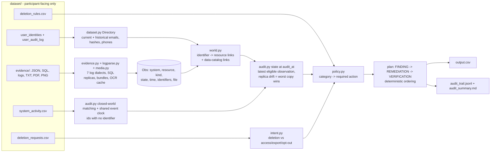

# Ghost Audit - proving that "deleted" really means deleted

[](https://www.npmjs.com/package/ghost-audit-mcp) MIT licensed · Python 3.9+ standard library only · zero LLM calls at runtime

**Ghost Audit** is a deterministic deletion-audit agent for privacy / DPO teams. It does not trust workflow statuses: it reconstructs
what personal data is actually still reachable across systems at the audit cut-off, and returns an ordered, evidence-cited
remediation and verification plan. It ships as a CLI (`ghost-audit`) and a read-only stdio MCP server (`ghost-audit-mcp`).

Built for HackerRank Orchestrate October'26 - *Ghost Data Still Exists*. The submission window closed before the entry
was uploaded, so this repository is published as a case study. The challenge dataset, the generated `output.csv` and the
OCR transcriptions of challenge images are **not** redistributed here; a synthetic demo dataset ships instead.

## Videos

| | |
|---|---|
| Product overview (97.6 s, music + on-screen English text) | [`ghostaudit-launch-v5.mp4`](https://github.com/miguelgarglez/ghost-audit/releases/download/v1.0.1/ghostaudit-launch-v5.mp4) |
| Technical walkthrough (219 s, music + on-screen English text) | [`ghostaudit-tech-v4-en.mp4`](https://github.com/miguelgarglez/ghost-audit/releases/download/v1.0.1/ghostaudit-tech-v4-en.mp4) |

Both are attached to the [v1.0.1 release](https://github.com/miguelgarglez/ghost-audit/releases/tag/v1.0.1).

## Case study

### The problem

A deletion request marked **Complete** in a workflow tool is a claim, not proof. Copies survive in search indexes, support
tickets, analytics profiles, replicas and backups; sync connectors can re-create deleted records; and the person may be
recorded under an e-mail or phone they no longer use. A privacy team answering a regulator needs to know, per request:

1. Did the person really ask for deletion? (`NOT_APPLICABLE` otherwise - never delete a customer who only asked for a copy of their data.)
2. What of the person is still reachable *at `audit_at`*? (records, identifiers still exposed in records that must be kept, leaky tombstones)
3. What can bring it back? (active sync connectors, restorable backups)
4. What must be done, in which order, and which checks prove it afterwards?

On the challenge's 518 evaluation requests, the workflow reported COMPLETE for 254 deletion requests; Ghost Audit found
personal data still reachable in 163 of them (64%).

### How it works

* **0 LLM at runtime.** Every answer is computed deterministically from the evidence files (JSON, SQL dumps, seven log dialects,
  TXT, and text from PDFs/screenshots). Same input, same output, about 1 s per full run, no API keys, no network.
* **Identity across time.** A directory of every e-mail, phone and hash a person ever had (from the audit log) resolves records
  that only carry an old identifier; matching is exact on normalised identifiers, so look-alike decoys never match.
* **State at the audit cut-off.** Only evidence captured and timestamped up to `audit_at` counts; if any replica still exposes a
  record, the record is exposed ("worst copy wins"). Reported statuses are never used as state.
* **Closed-world elimination + shared event clock.** Resource ids that appear with no identifier (e.g. a deleted account's 404 lookup)
  are linked by eliminating every candidate already explained by other requests on the same day and claim, then using the constant
  seconds-of-minute offsets between one request's worker events as a shared clock. Remaining ties are flagged `ambiguous`, not guessed.
* **Policy table.** `deletion_rules.csv` maps each data category to delete / redact / anonymize / retain / preserve-tombstone / block-restore;
  policy is a pure function `(kind, state) -> finding / remediation / verification`. Retained audit and legal records are verified present, never deleted.
* **Ordered plan.** Findings, then remediation (stop flows and restores before touching copies), then verification, sorted deterministically.
* **`confidence_v2`** orders the human review queue. It is a **priority signal, not a calibrated probability** (only 32 labelled samples exist);
  `output.csv` never depends on it ([`CONFIDENCE.md`](code/docs/CONFIDENCE.md)).

### Results and robustness

* Public samples: `deletion_status` accuracy 100%, step F1 99.4% (cases 11-32) / 99.2% (all 32); details in [`evaluation_report.md`](code/evaluation/evaluation_report.md)
  and the provable ceiling in [`limits_and_ceiling.md`](code/evaluation/limits_and_ceiling.md). The sample set is small, so treat these as optimistic.
* Stress harness: 29/29 adversarial scenarios (corrupt, empty, truncated or missing files, unknown dialects, BOM/CRLF/reordered CSVs, odd dates, 10x volume)
  finish without a crash and with a valid output ([`ROBUSTNESS.md`](code/docs/ROBUSTNESS.md)). It needs the challenge dataset.
* Tests: 54 in total. With the challenge dataset present all 54 pass. In this public repository the dataset-dependent modules skip with an
  explicit message and the demo/robustness-independent tests pass (`python3 -m unittest discover -s code/tests`).

## Install

```bash
npx -y ghost-audit-mcp                                         # MCP server on stdio (needs python3 >= 3.9 on PATH)
npx -y -p ghost-audit-mcp ghost-audit demo                     # CLI on the bundled synthetic dataset ("Lumen Lane Books")
pipx install git+https://github.com/miguelgarglez/ghost-audit   # Python package from GitHub (also pip / uvx)
uvx --from git+https://github.com/miguelgarglez/ghost-audit ghost-audit demo
```

npm package: <https://www.npmjs.com/package/ghost-audit-mcp>. Not published on PyPI. Point the tool at your own data with
`--dataset DIR` (or `GHOST_DATASET`). Full guide, uninstalling and from-source use: [`docs/INSTALL.md`](docs/INSTALL.md).

### Use from an MCP client

```json
{ "mcpServers": { "ghost-audit": { "command": "npx", "args": ["-y", "ghost-audit-mcp", "--dataset", "/path/to/dataset"] } } }
```

The server is read-only and exposes the same capabilities as the CLI (`describe`, `summary`, `cases`, `case`, `explain`, `evidence`,
`queue`, `ingest-report`, `whatif`, `verify`). An agent builds whatever artefact the conversation needs (risk dashboard, review queue,
case card, DPO brief): see [`AGENT_GUIDE.md`](code/docs/AGENT_GUIDE.md).

## From source

```bash
python3 code/ghost_cli.py demo                # synthetic demo, no dataset needed
python3 -m unittest discover -s code/tests   # tests (dataset-dependent ones skip without dataset/)
# with the challenge data in ./dataset/:
python3 code/main.py                          # writes output.csv
python3 code/tools/stress.py                  # 29 adversarial scenarios
```

Screenshots and PDFs are read from an OCR cache (`--ocr-cache DIR`) when present, otherwise through `pdftotext` / `tesseract` if installed;
media that yields no text is reported and its cases go to manual review. `code/tools/build_ocr_cache.py` rebuilds a cache.

## Architecture



### Domain model in one paragraph

Everything is normalised into an observation `Obs(file, captured_at, t, system, resource, kind, state, identifiers)`. A *kind* is a data category
from `deletion_rules.csv` (profile, search entry, support message/attachment, analytics profile, export, audit log, legal hold, backup, tombstone...)
plus `DATA_FLOW` for connectors. A *state* is what the evidence shows (`PRESENT`, `ABSENT`, `IDENTIFIABLE`, `ANONYMIZED`, `REDACTED`, `ACTIVE`, `DISABLED`, `BLOCKED`).
Policy is a pure function `(kind, state) -> violation? -> finding / remediation / verification operation`.

### Investigation approach

* **Identity** - the request e-mail may be historical. The directory knows every e-mail/phone/hash a person ever had (audit log), so a record that only
  carries an old e-mail hash still resolves. Look-alike decoys (`g.silva76.jr@...`) never match because matching is exact on normalised identifiers.
* **State at `audit_at`** - only observations with file `captured_at <= audit_at` *and* record time `<= audit_at` count. Later snapshots (re-synced data, restores) are ignored for state and never cited.
  Several copies of one record (primary, regional, reporting, read, failover replica): any exposed copy means exposed.
* **Claims are not proof** - `reported_status` and activity `reported_result` are never used as state. The activity stream is used only to *find* resource ids
  (e.g. a deleted account whose 404 lookup carries no identifier) via closed-world matching on report day and claim.
* **Policy** - delete / redact / anonymize / retain / preserve-tombstone / block-restore come from `deletion_rules.csv`; retained audit and legal records are *verified present*, never deleted.
* **Plan order** - findings (remaining record, exposed PII, active flow, restore risk), then remediation (disable flows, block restores, delete, redact, anonymize), then verification
  (absent, present, redacted, anonymized, flow disabled, restore blocked); inside a phase sorted by `system_id`, `resource_id`. So dependent copies are never modified before the process that recreates them is stopped.

## Metrics (full details: [`code/evaluation/evaluation_report.md`](code/evaluation/evaluation_report.md))

| | public samples case_11-32 (same generator as the 518) | all 32 samples |
|---|---:|---:|
| `deletion_status` accuracy | 100% | 100% |
| Step F1 (exact tuple) | 99.4% | 99.2% |
| Row exact match | 90.9% | 90.6% |

Output validation: all structural checks pass. Seven extra synthetic cases (historical identifiers, time-travel evidence, tombstone, non-deletion, restore + flow ordering,
replica drift, all-compliant) pass 7/7; 54 tests (27 regression + 13 agent CLI/MCP + 4 robustness + 7 confidence + 3 demo) all pass with the challenge dataset. A per-case `confidence_v2` orders the human review queue; it is a priority signal, not a calibrated probability ([`CONFIDENCE.md`](code/docs/CONFIDENCE.md)). 29 adversarial scenarios (`python3 code/tools/stress.py`) never crash the run and always yield a valid `output.csv` ([`ROBUSTNESS.md`](code/docs/ROBUSTNESS.md)). Deterministic, ~1 s, zero LLM tokens ([`usage_report.md`](code/evaluation/usage_report.md)).
The three remaining sample mismatches are provably not fixable from the data; the achievable ceiling is derived in [`limits_and_ceiling.md`](code/evaluation/limits_and_ceiling.md) (about 98% step F1).
Every requirement of the three spec documents is traced to code and tests in [`compliance_matrix.md`](code/evaluation/compliance_matrix.md); the ten key design decisions are in [`code/docs/DECISIONS.md`](code/docs/DECISIONS.md).

## Limitations (honest)

* A resource id that never appears with an identifier in any evidence file cannot be recovered: ~17% of requests miss their retained-audit-record verification step. This is proven from the data (no unlinked audit ids exist, archival events are unrelated noise, ids are not derivable) in `limits_and_ceiling.md`; we omit rather than invent ids.
* Account / anonymised-analytics ids without an identifier are linked by closed-world elimination on the activity stream plus a *shared event clock* (the seconds-of-minute offsets between a request's worker events are constant per event type). Hiding the identifier of random accounts and recovering them gives ~88% right; 18 requests remain a coin-flip and are flagged `ambiguous` in the audit trail.
* Screenshots are read with OCR + page-type rules, not a vision model; unseen console layouts need a mapping entry.
* Public samples are small (22 representative cases) - treat the accuracy numbers as optimistic.

## Roadmap

1. Connect to live systems (account, search, support, analytics, backup APIs) instead of snapshots; schedule continuous deletion audits.
2. Execute the plan behind approvals: disable flow, block restore, delete/redact/anonymize, then run the verification steps and attach the signed audit trail.
3. Vision-language model fallback for unseen screenshot layouts and multilingual free-text requests, kept behind the deterministic policy core.
4. Probabilistic linking with confidence scores and a reviewer queue for ambiguous matches; regulator-ready PDF report per request.

## Repository layout

```
code/main.py              entry point (writes ../output.csv)
code/ghost_cli.py         read-only agent CLI (JSON); code/ghost_mcp.py: stdio MCP server; logic in code/ghost/agent.py
code/ghost/               model, dataset, evidence parsers, logparse, media (OCR), world (links), audit (state + plan), policy, intent, io,
                          diag (ingest report), timeutil (tolerant timestamps), confidence (confidence_v2)
code/evaluation/          main.py (scoring + reports), validate_output.py, custom_cases.py, masking_test.py, ceiling_analysis.py,
                          evaluation_report.md, usage_report.md, audit_summary.md, limits_and_ceiling.md, compliance_matrix.md
code/tests/               regression + agent CLI/MCP + robustness + confidence tests (python3 -m unittest discover -s code/tests)
code/docs/DECISIONS.md    the 12 key technical decisions (mirrored to docs/); AGENT_GUIDE.md: CLI/MCP for agents;
                          ROBUSTNESS.md: behaviour on unseen/malformed input, limits, how to extend;
                          CONFIDENCE.md: confidence_v2 method, reliability tables, limits
code/tools/               build_ocr_cache.py, package.py (portable packager), stress.py (adversarial harness)
Makefile                  make all | run | validate | test | eval | stress | package
package.sh                builds code.zip
SUBMISSION.md             what was prepared for the HackerRank upload slots
```
